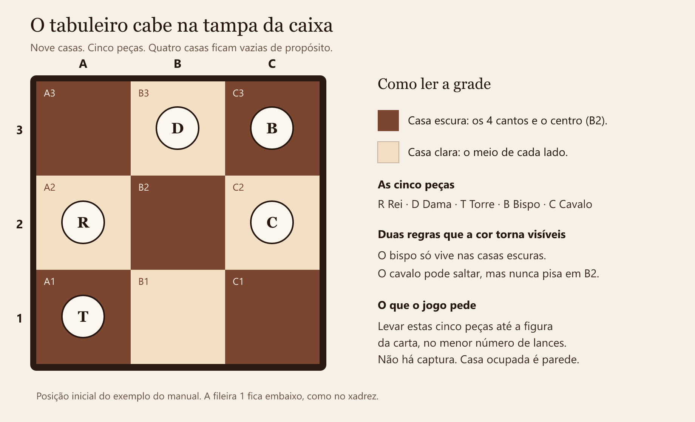
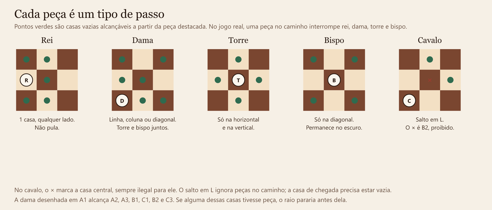
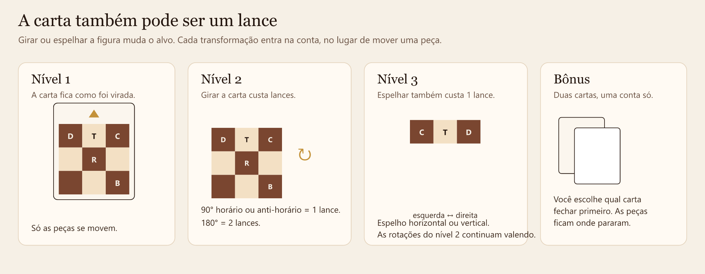
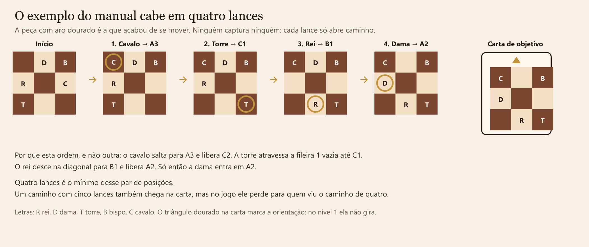

# The Royal Chess

Edição digital de um estudo de xadrez em miniatura: cinco peças, um tabuleiro de nove casas e uma carta que mostra exatamente onde elas precisam chegar. Ganha quem enxerga o caminho mais curto e consegue prová-lo.

O desenvolvimento desta versão foi feito por **Diego Duenhas** ([diegoduenhas.com.br](https://diegoduenhas.com.br)). Ela é baseada no jogo físico da empresa **Philos** chamado **The Royal Chess** — publicado no catálogo da Philos como **The Royal Study** (artigo 2850), criado pelo designer **Stan van Rooijen**. A Philos indica o jogo para 1 ou 2 pessoas, a partir dos 8 anos, em partidas de cerca de 20 minutos. Os objetivos de aprendizagem declarados pela editora são concentração, criatividade, raciocínio lógico e rapidez.

Esta página explica a filosofia, a mecânica e o uso pedagógico. As regras do produto físico continuam sendo as da Philos.



## A filosofia: um estudo, não uma batalha

No xadrez, um *estudo* é uma posição composta de propósito. Sobram poucas peças, existe uma ideia precisa e o valor do lance está na necessidade, não no espetáculo. O nome *The Royal Study* leva isso ao pé da letra. O tabuleiro inteiro cabe na tampa da caixa. Não há peões, não há captura, não há xeque. O conflito foi trocado por congestionamento: cinco oficiais disputam espaço em nove casas, e quatro casas vazias são o ar que o problema precisa para respirar.

A pergunta de cada rodada é sempre a mesma. Dada a posição em que as peças estão agora, qual é o menor número de lances que as deixa iguais à figura da carta?

Essa pergunta muda o que conta como um bom lance. Um lance legal que chega na carta em sete movimentos perde para um caminho de quatro. O jogo treina economia de intenção. Antes de tocar numa peça, a pessoa anuncia um número. Esse número é uma promessa. Se a execução confirma a promessa, vale um ponto. Se a promessa era otimista demais, o ponto vai para o outro lado. A ampulheta existe para que a velocidade de ver e a honestidade da conta convivam: quem fala primeiro abre a janela, e o oponente ainda pode enxergar um caminho mais curto.

Depois do ponto, as peças **ficam onde pararam**. A carta seguinte nasce da posição que você mesmo construiu. A partida não reinicia o tabuleiro a cada problema. Isso aproxima o estudo de uma partida de verdade, em que a posição de agora é herança do lance anterior.

## Por que este jogo treina movimentação

Quem está aprendendo xadrez costuma conhecer o nome das peças antes de enxergar o que elas realmente fazem. Numa partida completa, essa lacuna se esconde. Há 32 peças, capturas, ameaças e a pressa de “fazer alguma coisa”. O olho vai para a peça que pode ser tomada, e a geometria do movimento passa em branco.

Aqui a geometria é o jogo inteiro. Por isso ele serve como treino, na mesa da sala ou antes de abrir um tabuleiro de 64 casas.

**Cada tipo de passo aparece em todo problema.** São exatamente um rei, uma dama, uma torre, um bispo e um cavalo. Não dá para passar a partida inteira movendo só peão. Em poucos minutos a pessoa usou os cinco modos de andar.

**A casa ocupada é parede.** Sem captura, a única pergunta útil é: esta linha está livre até a casa vazia? Rei, dama, torre e bispo param diante de qualquer peça. O aluno passa a contar casas vazias no caminho, que é o gesto motor de calcular uma torre aberta ou um bispo longo numa partida real.

**A dama deixa de ser “a peça que vai a qualquer lugar”.** No 3×3 ela é, de forma visível, a torre mais o bispo. Quem treina aqui descreve o lance da dama como “subindo a coluna” ou “na diagonal”, e leva esse vocabulário para o tabuleiro grande.

**O bispo fica preso à cor, e a cor está desenhada no chão.** As casas escuras são os quatro cantos e o centro. As claras são o meio de cada lado. O bispo começa numa casa escura e só anda na diagonal, então ele nunca pisa numa casa clara. A regra clássica — “o bispo não troca de cor” — vira algo que se vê, sem precisar de um tabuleiro de 64 casas para perceber.

**O cavalo vira um conjunto pequeno de chegadas.** O L (duas casas numa direção e uma para o lado) cabe na palma da mão. Ele é a única peça que salta. E há uma regra própria deste jogo: o cavalo nunca pode ser colocado na casa central, B2. O centro deixa de ser um atalho automático. A pessoa escolhe um canto ou uma borda, e precisa dizer o L em voz alta antes de soltar a peça.

**O rei é a dama com passo de uma casa.** Colocar os dois lado a lado ensina alcance. A mesma direção, distâncias diferentes.

**O lance bom é anunciado antes de ser feito.** A rodada pede um número mínimo e só depois a execução. Isso é cálculo: simular a sequência de cabeça, segurar o tabuleiro imaginário e só então mover. É a habilidade que o xadrez competitivo chama de visualizar a variante. Aqui ela é o placar.

**Chegar na carta e chegar no mínimo são coisas diferentes.** Um caminho longo também reproduz a figura. O ponto, porém, fica com quem usou menos lances. O treino deixa de ser “consegui” e passa a ser “consegui sem desperdício”. Na versão digital, o solucionador mostra esse mínimo quando a pessoa quer comparar o próprio plano com o caminho mais curto. A diferença entre os dois números é o conteúdo da aula.

**A posição não é apagada.** Como as peças permanecem, o problema seguinte começa de um lugar que já tem história. O aluno sente que um lance de agora abre ou fecha o problema de depois — a mesma razão pela qual, no xadrez, desenvolve-se peça pensando na casa que ela vai ocupar, e não só na casa que ela deixa.

**Girar a carta é aprender a sentar do outro lado da mesa.** No nível 2, a mesma figura pode ser lida de cabeça para baixo ou de lado, e cada giro entra na conta. É o treino de quem joga de pretas e precisa reconhecer um padrão que aprendeu olhando da outra ponta. No nível 3, o espelho acrescenta a reflexão: esquerda e direita trocam de lugar, como numa casa vista no espelho.

Um jeito prático de usar isso em aula ou em casa:

1. Antes de mover, a pessoa diz o nome da peça, a casa de saída e a casa de chegada (“torre de A1 para C1”).
2. Em seguida diz por que o caminho está livre, ou por que o cavalo pode saltar.
3. Para o bispo, a pergunta fixa é: “ele continua numa casa escura?”
4. Para o cavalo, o dedo desenha o L e para se a chegada for B2.
5. Só então se anuncia o total de lances. Quem está ensinando pode pedir uma segunda tentativa com um número menor, antes de aceitar a primeira ideia.
6. Quando a carta fecha, as peças ficam. A conversa seguinte é: “o que esta posição já deixa pronto para a próxima carta?”

As casas legais destacadas na versão digital são andaime. Servem no começo, para a regra ficar visível. Quando o objetivo é treinar a visualização, o combinado passa a ser anunciar o lance antes do clique.

## As regras, em linguagem simples

Há cinco peças de madeira e 60 cartas de objetivo. O tabuleiro é a grade 3×3 da caixa. As colunas são A, B e C, da esquerda para a direita. As fileiras são 1, 2 e 3, de baixo para cima. A1 é o canto inferior esquerdo. B2 é o centro.

Uma carta mostra um desenho das cinco peças já colocadas. O trabalho é fazer o tabuleiro ficar igual a esse desenho.

### O que toda peça obedece

- A peça só entra numa casa **vazia**. Ninguém captura ninguém.
- Rei, dama, torre e bispo não atravessam peça nenhuma. Se houver alguém no caminho, o lance acaba antes dessa casa.
- O cavalo é a exceção: ele salta. A casa onde ele pousa precisa estar vazia, e essa casa não pode ser o centro.

### Como cada uma anda



| Peça | O passo | O cuidado |
| --- | --- | --- |
| Rei | Uma casa para qualquer lado: reto ou em diagonal. | Não pula. |
| Dama | Quantas casas quiser, reto ou em diagonal. | Para na primeira peça que encontrar. |
| Torre | Quantas casas quiser, na horizontal ou na vertical. | Para na primeira peça que encontrar. |
| Bispo | Quantas casas quiser, só na diagonal. | Fica sempre nas casas escuras: os quatro cantos e o centro. |
| Cavalo | Em L: duas casas numa direção e uma para o lado. | Salta por cima. Nunca pousa em B2. |

### Como corre uma rodada

1. **Revela-se a carta.** Na primeira vez, uma carta também serve para montar as peças na caixa. Essa carta sai de cena. A seguinte é o desafio.
2. **Alguém anuncia um número.** Os dois olham o tabuleiro e a carta e pensam no mínimo de lances. Quem falar primeiro um número vira a ampulheta.
3. **O outro lado decide.** Enquanto a areia corre, o oponente pode aceitar aquele número ou entrar no lugar, prometendo resolver com **menos** lances. Nesta versão digital a ampulheta dessa decisão dura 20 segundos.
4. **Quem ficou com o número executa.** Se cumprir o que anunciou, marca 1 ponto. Se não cumprir, o ponto vai para o adversário. Se o oponente desafiou com menos lances e conseguiu, o ponto é dele. Se desafiou e não conseguiu, o ponto volta para quem tinha anunciado primeiro.

O primeiro a chegar a **6 pontos** vence. A cada ponto, as peças continuam nas casas finais, uma carta nova entra e a conta recomeça do zero.

Dá para jogar sozinho, em dupla no mesmo aparelho, ou contra o robô da versão digital. Sozinho, o desafio é bater o próprio número e, se quiser, comparar com o mínimo calculado pelo jogo. A Philos também prevê o uso cooperativo: duas pessoas resolvem a carta juntas.

### Os níveis



- **Nível 1.** A carta fica na orientação em que foi colocada na mesa. Só as peças se movem.
- **Nível 2.** Durante a execução, a carta pode girar. Um giro de 90°, para qualquer lado, custa **1 lance**. Um giro de 180° custa **2 lances**. Girar é uma ação, tão real quanto mover o rei.
- **Nível 3.** Além dos giros, a carta pode ser espelhada na horizontal ou na vertical. Cada espelho custa **1 lance**.
- **Desafio bônus.** Valem duas cartas ao mesmo tempo, em qualquer nível. A pessoa anuncia o total para as duas, escolhe qual fechar primeiro e pode gastar giros ou espelhos numa delas, conforme o nível. Quando a primeira carta é cumprida, as peças ficam ali e a segunda carta começa dessa posição.

### Um exemplo completo

O manual da Philos mostra um desafio que fecha em quatro lances:

1. Cavalo para a superior esquerda (A3).
2. Torre para a inferior direita (C1).
3. Rei para o inferior centro (B1).
4. Dama para a meio esquerda (A2).



A ordem importa. O cavalo salta para A3 e deixa C2 livre. A torre atravessa a primeira fileira, que está vazia, e ocupa C1. O rei desce em diagonal para B1 e abre A2. A dama entra em A2. O desenho da carta aparece. Qualquer volta extra também chegaria lá, e seria um lance a mais do que o necessário.

## Para quem o jogo é adequado

A recomendação da Philos é **a partir de 8 anos**, para 1 ou 2 jogadores. Peças pequenas pedem o cuidado habitual com crianças menores de 3 anos. A adequação pedagógica é um pouco mais fina do que um único número, porque cada nível pede uma operação mental diferente.

| Faixa | Idade escolar típica | O que cabe bem | O que ainda pesa |
| --- | --- | --- | --- |
| 6 e 7 anos | 1º e 2º ano | Conhecer o nome e o passo de uma peça por vez, numa casa só, com um adulto nomeando as direções. | Estimar um mínimo, respeitar bloqueio e jogar no tempo da ampulheta. |
| 8 a 10 anos | 3º ao 5º ano | Nível 1 completo: coordenadas A1–C3, caminho livre, cavalo em L, bispo na cor, anunciar um número curto e executar. É a faixa para a qual o jogo físico foi desenhado. | Giro e espelho como parte da conta de lances. |
| 11 a 14 anos | 6º ao 9º ano | Níveis 2 e 3, desafio entre pares, bônus com duas cartas e a conversa sobre simetria e giro de 90°. | Pouco. A ampulheta pede mediação se o grupo ainda se frustra com tempo curto. |
| 15 anos em diante | Ensino médio, clubes e adultos | Partida inteira até 6 pontos, comparação com o caminho mínimo e leitura do problema como busca: estado inicial, estado final, custo de cada ação. | Nada estrutural. O tabuleiro pequeno continua difícil, porque a dificuldade está na economia, não no tamanho. |

O jogo também serve a quem já joga xadrez e quer isolar a movimentação. Um enxadrista experiente não está “abaixo” do 3×3. Ele está treinando, sem o ruído das capturas, a mesma pergunta que uma partida faz o tempo todo: qual peça precisa sair do caminho, e em que ordem?

Na escola, o melhor uso é mediado. O professor escolhe o nível, decide se a casa legal aparece destacada e se o mínimo calculado pelo programa entra antes ou depois da tentativa do aluno. Sozinho, a partir dos 8 anos, o nível 1 já é um passatempo fechado. Com duas crianças, a ampulheta introduz uma competição curta, de uma carta por vez, com regra de vitória clara.

## Onde isso encontra a BNCC

O jogo não substitui um componente curricular e não “cumpre” uma habilidade só por ser jogado. Ele oferece uma situação em que habilidades já previstas na Base Nacional Comum Curricular, e no complemento de Computação, podem ser exercidas de propósito. A mediação do professor é o que transforma a partida em aula.

Os códigos abaixo seguem a BNCC do Ensino Fundamental (2018) e o complemento **Computação na Educação Básica**, anexo ao Parecer CNE/CEB nº 2/2022, instituído pela Resolução CNE/CEB nº 1/2022.

### Competências gerais que a partida exercita

A **Competência Geral 2** pede curiosidade intelectual, investigação, elaboração e teste de hipóteses e resolução de problemas. Cada carta é uma hipótese numérica: “eu fecho em cinco”. A execução testa a hipótese na hora.

A **Competência Geral 5** trata do uso de tecnologias digitais para resolver problemas e exercer autoria. A versão digital é o artefato: o aluno lê uma representação, age sobre ela e recebe um retorno verificável. O programa não decide pelo aluno enquanto ele ainda está estimando.

Na Matemática do Ensino Fundamental, a partida conversa sobretudo com as competências específicas de **raciocínio lógico e investigação**, de **uso de processos matemáticos para modelar e resolver problemas** e de **enfrentamento de situações-problema em vários registros**, inclusive a descrição de um passo a passo. Jogar em dupla, com um plano anunciado em voz alta, também mobiliza o trabalho coletivo em que o modo de pensar do outro é parte da solução.

### Matemática: do mapa da sala ao giro de 90°

A unidade temática é Geometria, no eixo de localização, movimentação e, mais tarde, transformações.

Nos anos iniciais, o tabuleiro é uma malha pequena com ponto de referência explícito. Dizer “a torre está em A1” é descrever localização. Dizer “ela vai para C1 passando por B1 vazia” é descrever deslocamento, direção e sentido. Isso sustenta um percurso que a BNCC já desenha:

- **EF01MA11** e **EF01MA12** — localização com a própria posição e com um ponto de referência, usando direita, esquerda, em frente, atrás. No 1º ano o jogo inteiro é cedo; uma casa e uma peça, nomeadas pelo adulto, cabem como jogo de linguagem espacial.
- **EF02MA12** — localização e deslocamento com mais de um ponto de referência, indicando mudança de direção e de sentido.
- **EF04MA16** — deslocamentos em malhas quadriculadas, com direita e esquerda, mudança de direção e noções de paralelo e perpendicular. A torre anda em linhas e colunas; o bispo anda na diagonal, que corta essas linhas.
- **EF05MA14** e **EF05MA15** — coordenadas no primeiro quadrante, representação de deslocamentos, mudanças de direção e de sentido e giros. As letras A–C e os números 1–3 são um plano cartesiano de bolso. O nível 2 torna o “giro” da habilidade EF05MA15 um objeto da jogada, não um enfeite da fala: girar a carta 90° custa um lance e muda o problema.

Nos anos finais, o mesmo material sobe de patamar sem trocar de jogo:

- **EF07MA20** — simétrico de figuras em relação aos eixos. O espelho horizontal e o vertical do nível 3 são essa operação, feita sobre a carta.
- **EF08MA18** — figuras obtidas por composição de translação, reflexão e rotação. Uma solução de nível 3 é exatamente isso: a peça se translada segundo sua regra, e a carta pode ser girada e refletida, com um custo para cada transformação.

O professor não precisa fingir que o aluno demonstrou a habilidade formal só porque venceu a carta. O registro é que faz a ponte: o aluno desenha a malha, escreve as coordenadas de saída e de chegada, marca o giro e compara dois caminhos. Aí a jogada vira produção matemática.

### Computação: a carta é um problema com entrada, saída e custo

O complemento de Computação organiza o Fundamental em três eixos: **Pensamento Computacional**, **Mundo Digital** e **Cultura Digital**. O jogo incide no primeiro. Ele não ensina hardware, protocolo ou política de rede, e não deve ser apresentado como se ensinasse.

O que ele faz bem é dar um problema pequeno o bastante para as práticas do pensamento computacional aparecerem sem tela de programação.

**O tabuleiro é uma matriz.** Cada peça ocupa uma posição definida por duas coordenadas. Mover é uma manipulação simples dessa matriz: a origem fica vazia, o destino recebe a peça. Isso é o objeto de **EF04CO01** — reconhecer que um objeto pode ser representado por uma matriz em que cada componente tem coordenadas, e fazer manipulações simples sobre essa representação. No 7º ano, **EF07CO01** pede soluções em que registros e matrizes descrevem a informação. A versão digital guarda o tabuleiro exatamente assim, como uma lista de nove posições. O aluno não precisa programar para ver a estrutura; o professor pode, se quiser, abrir o estado da casa e mostrar que a partida cabe numa grade.

**A solução é um algoritmo.** Uma sequência de lances é um passo a passo que outra pessoa, ou o próprio tabuleiro, consegue executar. Errar a ordem faz o algoritmo falhar, mesmo que cada lance isolado seja legal. Isso conversa com **EF15CO02**: construir e simular algoritmos, sozinho ou em colaboração, que resolvam problemas com sequências de instruções. Anunciar o plano em voz alta, antes de mover, é simular.

**O problema se parte.** “Qual peça está no caminho da torre?” é um subproblema. “O cavalo consegue sair sem ocupar o centro?” é outro. A carta fecha quando as partes se recombinam numa ordem. É a decomposição de **EF15CO04**: dividir um problema complexo em partes menores, resolvê-las e combinar as soluções. No bônus, a decomposição é explícita: duas cartas, uma de cada vez, e a saída da primeira é a entrada da segunda.

**Entrada e saída estão desenhadas.** A posição atual é a entrada. A carta é a saída esperada. Cada lance, giro ou espelho é uma transformação com custo 1 (ou 2, no giro de 180°). **EF69CO05** define problema como relação entre insumos de entrada e resultados de saída. Poucos jogos de mesa deixam essa definição tão literal.

**O mesmo problema, várias instâncias.** São 60 cartas e, a cada ponto, uma posição inicial diferente. A regra das peças não muda. Muda o caso. **EF06CO06** pede comparar instâncias de um mesmo problema, achar o que se repete e o que varia, e tratar os casos de forma genérica. A regra do bispo, por exemplo, é o parâmetro que vale para todas as cartas: se a casa não é escura, o lance é ilegal, qualquer que seja o desenho.

No Ensino Médio, a versão digital acrescenta um espelho computacional honesto. O caminho mínimo é calculado por uma busca que examina os estados do tabuleiro — as 15.120 maneiras de colocar cinco peças distintas em nove casas — junto com as orientações possíveis da carta. O aluno pode, depois de tentar, ver que existia um caminho mais curto e refazer o próprio plano em níveis de detalhe: primeiro “a torre está presa”, depois a sequência concreta. Isso sustenta **EM13CO02**, que pede explorar a solução por refinamentos, em vários níveis de abstração, da especificação até a execução. A conversa útil nessa idade não é “o computador ganhou”. É “o computador procurou todos os estados na ordem do custo, e por isso o primeiro caminho que ele achou é o mais curto”. Aí a eficiência deixa de ser um slogan e vira uma propriedade observável de um problema pequeno.

### O que a escola não deve esperar do jogo

Ele não cobre álgebra, grandezas, probabilidade, nem os eixos Mundo Digital e Cultura Digital, fora o fato de a versão digital ser um artefato usado com responsabilidade em sala. Também não substitui o xadrez escolar completo: não há peão, roque, captura, xeque-mate nem estratégia de abertura. O lugar dele é anterior e paralelo a isso — o lugar em que o movimento, a coordenada, o bloqueio, a simetria e o passo a passo ficam limpos o bastante para serem ensinados.

## O que a versão digital acrescenta

A edição feita por Diego Duenhas coloca o mesmo jogo numa mesa em 3D: caixa, peças, carta e ampulheta. Há três modos — solo, dois jogadores no mesmo aparelho e partida contra o robô — e os níveis 1, 2, 3 e o desafio bônus.

O programa só oferece casas legais para a peça escolhida, conta os lances, aplica giro e espelho com o custo certo e sabe o mínimo da posição. Esse mínimo serve para o robô jogar e para a pessoa, quando quiser, conferir se havia um caminho mais curto. As 60 cartas respeitam as duas restrições que tornam uma posição jogável: o bispo está sempre numa casa escura e o cavalo nunca começa no centro. O exemplo de quatro lances do manual está entre elas.

## Créditos

- **Versão digital:** Diego Duenhas — [diegoduenhas.com.br](https://diegoduenhas.com.br)
- **Jogo físico:** *The Royal Chess*, baseado no jogo de tabuleiro da **Philos** publicado como **The Royal Study**, design de **Stan van Rooijen**. Componentes originais: cinco peças (rei, dama, torre, bispo e cavalo), 60 cartas de objetivo e uma ampulheta. Regras, nome e concepção do jogo físico pertencem aos seus autores e à editora.
- **Referências curriculares:** Base Nacional Comum Curricular (Educação Básica, 2018); Computação na Educação Básica — complemento à BNCC, Parecer CNE/CEB nº 2/2022 e Resolução CNE/CEB nº 1/2022.

## Como abrir esta versão

É um aplicativo web em React, Vite, TypeScript e Three.js.

```bash
npm install
npm run dev
```

O servidor de desenvolvimento sobe na porta 3000. `npm run lint` confere os tipos com o TypeScript. `npm run build` gera a versão de produção.
